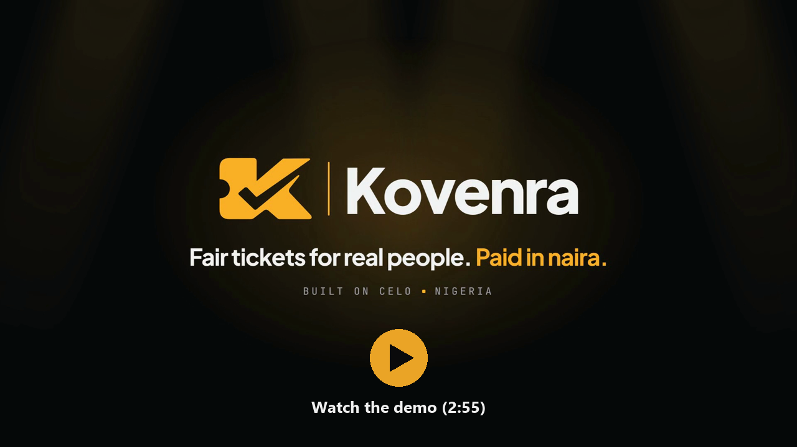
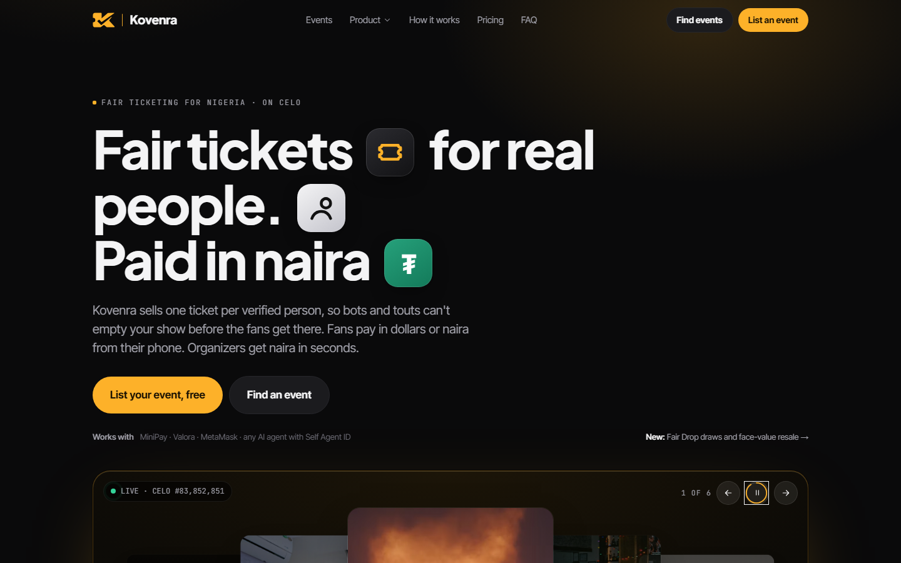
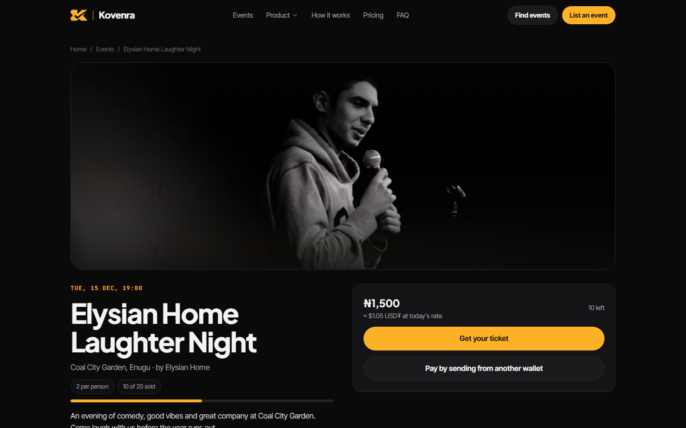
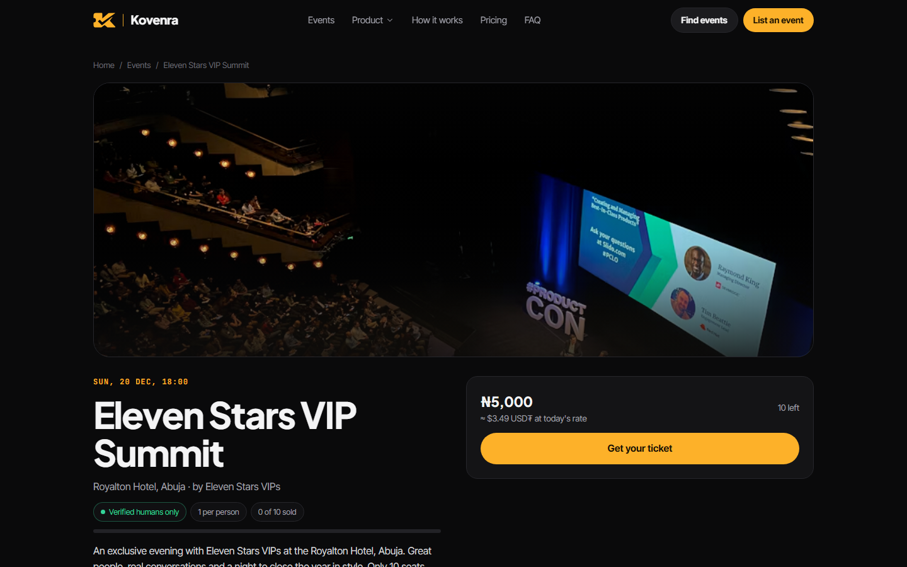
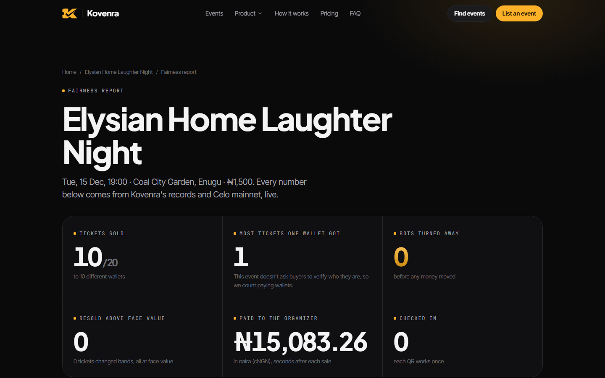
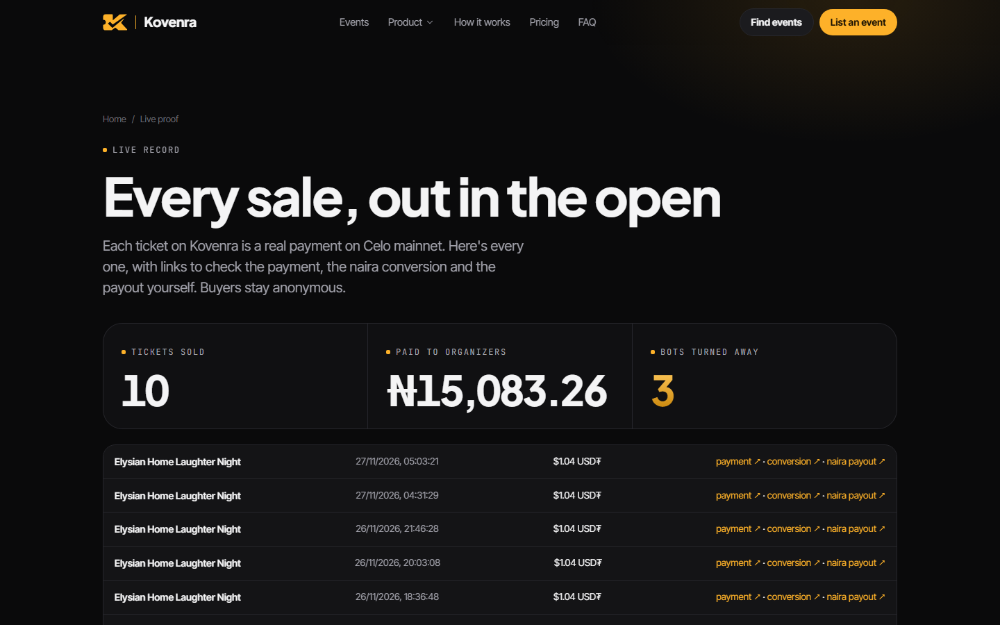
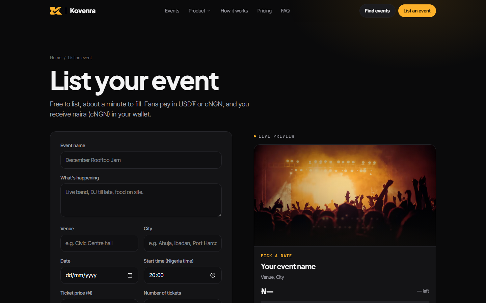
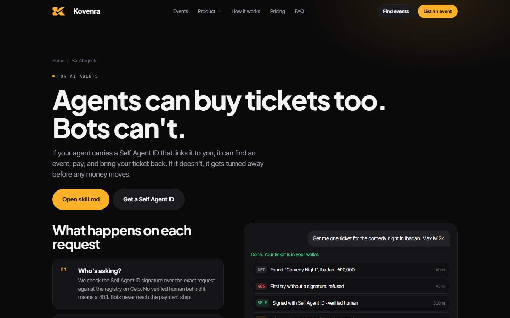
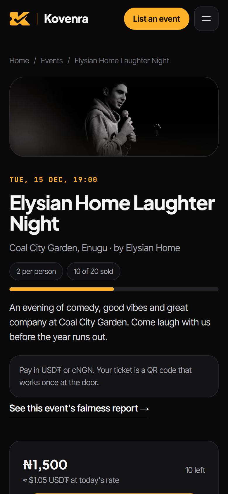

# Kovenra

**Fair tickets for real people, paid in naira, on Celo.**

Kovenra is a ticket counter for events in Nigeria that counts people, not accounts. Organizers list an event in two minutes. Fans pay the naira price in dollars (USD₮) over x402 from their phone, and Kovenra's agent converts it to naira (cNGN) on Textile FX and pays the organizer's own wallet within seconds. For shows that sell out, every buyer proves once with Self Agent ID that they are a real, unique person, and all of one person's AI agents share that person's limit. No bots, no touts, no waiting for a payout.

[**Live app: kovenra.xyz**](https://kovenra.xyz) · [**Demo video (2:55)**](https://youtu.be/4DXQQ04w0ao) · [Every sale, live](https://kovenra.xyz/proof) · [Post on X](https://x.com/RaphElevator/status/2126167520813990031) · [Submission](SUBMISSION.md) · [Agent](AGENT.md) · [Self Agent ID proof](docs/self-agent-id-proof.md) · [Internal review](AUDIT.md)

[](https://youtu.be/4DXQQ04w0ao)

*Watch the 2:55 demo on YouTube. It walks through the live site; how it was made is in [video/README.md](video/README.md).*

Built for the Celo **Agents Open for Business** hackathon (Loops House), Stablecoin Corridors and Self Agent ID tracks.

## At a glance

| | |
|---|---|
| **Network** | Celo mainnet (chain 42220), live since 2026-11-25 |
| **Real use** | **2 organizers.** Elysian Home (Enugu): **12 tickets to 12 different buyers, ₦18,102 paid out in cNGN**. Eleven Stars VIPs (Abuja): verified-humans event, **first ticket sold to a passport-verified member** (Self Agent ID #226) |
| **Stablecoin corridor** | USD₮ → cNGN on Textile FX (RFQ v2) for every sale, paid to the organizer's own wallet. Approve, swap and payout all carry our ERC-8021 tag |
| **x402** | Fans and agents pay over x402 through Celo's facilitator. PayTo: `0x617B…184Fb` |
| **Identity** | ERC-8004 agent **#10137**. Self Agent ID **#223** (verified, passport strength). Demo agent #224 |
| **Self Agent ID in the product** | Verified-humans events refuse unsigned or unverified buyers (403) and count tickets per human, so a person's second agent gets 429. [Live proof](docs/self-agent-id-proof.md) |
| **Fairness** | Fair Drop (a draw seeded by a Celo block hash), resale only at face value, a public fairness report for every event, QR tickets that check in once, and an optional VIP door check where the guest re-proves with their own passport |
| **App** | Landing page with live chain data, events, event pages, organizer dashboard and door scanner, plus 15 more pages; built for phones; works in MiniPay |
| **Tests** | 32 unit tests (ticket counter, per-human limits, settlement, tags, Fair Drop, resale, send-to-pay, fairness report, friendly errors) |

## Contents

- [The idea in one minute](#the-idea-in-one-minute)
- [Live on Celo mainnet](#live-on-celo-mainnet)
- [Real use](#real-use)
- [Why Kovenra](#why-kovenra)
- [Product tour](#product-tour)
- [How a sale works](#how-a-sale-works)
- [Self Agent ID: one person, one seat](#self-agent-id-one-person-one-seat)
- [Fair Drop, resale and the fairness report](#fair-drop-resale-and-the-fairness-report)
- [Architecture](#architecture)
- [Verification and security](#verification-and-security)
- [Quickstart](#quickstart)
- [Repository layout](#repository-layout)
- [Documentation](#documentation)
- [Honest notes and risks](#honest-notes-and-risks)

## The idea in one minute

A big show goes on sale in Lagos, Abuja or Enugu. The link goes live and it's sold out in minutes. By evening the same tickets are on WhatsApp for three times the price. Fans lose, organizers get blamed, and the only winners are people running bots and fake accounts.

It happens because ticket sites count **accounts**. One tout with a hundred accounts gets a hundred tries. Kovenra counts **people**:

| Problem | Kovenra |
|---|---|
| Bots and duplicate accounts clear the show | Verified-humans events: every buyer, or their agent, carries a Self Agent ID; tickets are counted per human, across all their agents |
| The fastest bot wins a hot drop | Fair Drop: verified fans enter, a Celo block hash picks the winners, anyone can recompute it |
| Touts resell at 3x | Resale only at face value, through Kovenra; the old QR stops working |
| Organizers wait days for money, in the wrong currency | Every sale is converted to naira (cNGN) on Textile FX and paid to the organizer's wallet in seconds |
| Fans can't check any of it | A public fairness report per event, with every transaction on Celo |

## Live on Celo mainnet

Everything below is live on Celo mainnet and was checked by direct onchain reads on 2026-11-27.

**Wallets and identities**

| Component | Address / ID |
|---|---|
| **Kovenra agent wallet** (x402 PayTo, ERC-8004 owner, signs every tagged swap and payout) | [`0x617B299FF63AB479283c895d2F3DF95efEf184Fb`](https://celoscan.io/address/0x617B299FF63AB479283c895d2F3DF95efEf184Fb) |
| ERC-8004 identity | **#10137** in the [Identity Registry](https://celoscan.io/address/0x8004A169FB4a3325136EB29fA0ceB6D2e539a432), registration tx [0x09cd…c9c0](https://celoscan.io/tx/0x09cd538ed3a2974b373dff71d83797195f31c4fb4a0bf57d24828227eb96c9c0) |
| Self Agent ID | **#223** [`0xBecc…0656`](https://agent-api.self.xyz/api/agent/info/42220/223), verified, passport strength, valid to 2027-11-27 |
| Self demo agent (same human) | **#224** [`0x753f…4A55`](https://agent-api.self.xyz/api/agent/info/42220/224) |
| Self Agent ID registry | [`0xaC3DF9ABf80d0F5c020C06B04Cced27763355944`](https://celoscan.io/address/0xaC3DF9ABf80d0F5c020C06B04Cced27763355944) |
| Attribution tag (ERC-8021) | `celo_09b3ddb9ca23` (plus `kovenra`) |
| Organizer: Elysian Home | [`0x1988…b98a`](https://celoscan.io/address/0x1988abfcea912a5de5adaef49176215dd113b98a) |
| Organizer: Eleven Stars VIPs | [`0x19b8…dc68`](https://celoscan.io/address/0x19b81d61a20ca92f47cd821c85a037293b6cdc68) |
| Tokens | USD₮ [`0x4806…3D5e`](https://celoscan.io/token/0x48065fbBE25f71C9282ddf5e1cD6D6A887483D5e), cNGN [`0xF682…1a4f`](https://celoscan.io/token/0xF6829D7393dAe24509eb1E52eE8e572e2E271a4f) |

**Sales for Elysian Home Laughter Night** (each row: the fan's x402 payment, our tagged Textile conversion, our tagged naira payout to the organizer)

| # | Time (UTC) | Paid | x402 payment | Textile conversion | cNGN payout |
|---|---|---|---|---|---|
| 1 | 2026-11-26 12:59 | 1.05 USD₮ | [0xa26f…c50f](https://celoscan.io/tx/0xa26f718142a0c1f9a5134cc5556365e4d2034a485c0fe47a6a5367826b55c50f) | [0xf898…be13](https://celoscan.io/tx/0xf89803e41a0111b3f33cee1c74d503c92ab284c124ec1625e259e22bf8bbbe13) | [0x85a0…b312](https://celoscan.io/tx/0x85a060891d478b86a951eb260e19282ab54353777e66881c3b2a81d4c2a4b312) |
| 2 | 2026-11-26 14:00 | 1.05 USD₮ | [0x6f42…ba36](https://celoscan.io/tx/0x6f427661f9b3c3e6adc967d5f9ba46bae18d20e4c360b4f29454cadd30b7ba36) | [0x815e…bdd8](https://celoscan.io/tx/0x815e848243c2e88525fdc3a8f98921a2c3a4c2ff4a0e9ce6bececb48e84ddbd8) | [0xe6e4…39a4](https://celoscan.io/tx/0xe6e47cc1fab70ebab0fa61c55437ce38c866256f997472c3d1df9035607539a4) |
| 3 | 2026-11-26 16:29 | 1.05 USD₮ | [0x116e…6cb](https://celoscan.io/tx/0x116e107212c150bb327db114109e03986379b64d048466368e34126f9c6ff6cb) | [0x5f46…419a](https://celoscan.io/tx/0x5f4608f0941301d71d56049e517321cd8f1022f86290c56324a07ad0e166419a) | [0x34a9…fb0e](https://celoscan.io/tx/0x34a97903ae801c99152034f71be2a72f4f29362dba3942380f31deb71294fb0e) |
| 4 | 2026-11-26 17:24 | 1.05 USD₮ | [0xe052…b29a](https://celoscan.io/tx/0xe052b25a58f427c7a2e974751df6f24bac69b4dd0b6124ca67f466962e29b29a) | [0x522d…3dd7](https://celoscan.io/tx/0x522d189883c93a0adc46a00630e5f207762b8fb8beee2438a9a1c441ed2c3dd7) | [0xb536…0ae8](https://celoscan.io/tx/0xb536acf64908e2d319e79da136ff237a344e10b1b831e088d81edfd7a1370ae8) |
| 5 | 2026-11-26 17:34 | 1.05 USD₮ | [0x437b…6e14](https://celoscan.io/tx/0x437b493f4fc31ef4a07b984d20eff8e5c27a2cc91d51c46d43cd0596306e6e14) | [0x6a9a…f5d3](https://celoscan.io/tx/0x6a9a7079eb9932ea98f3e996cd8a298e38384490a42c9f3270fde6d79d95f5d3) | [0x8526…ea31](https://celoscan.io/tx/0x852686d783bd437581033d6d13be9060a55e15f07ef01a2953062a61c5c8ea31) |
| 6 | 2026-11-26 17:36 | 1.05 USD₮ | [0x6900…9fa0](https://celoscan.io/tx/0x690017a877938da656cb09aa5648578d46c7c6e6a2782cf004a26655a0c29fa0) | [0xe19c…dce9](https://celoscan.io/tx/0xe19c4135dda708d4cb2b99bd926324639c0ab90832670c3cc81f9e5f5214dce9) | [0x898a…5c68](https://celoscan.io/tx/0x898aa7742b4933ca42716ca991700d48ad66ece0fae1295f64187f195d375c68) |
| 7 | 2026-11-26 19:03 | 1.05 USD₮ | [0xfc77…d66d](https://celoscan.io/tx/0xfc776a4557bc69da13b883ab516868ddc09660dc4fa719b88fd1ee4ec2e1d66d) | [0x2527…24fa](https://celoscan.io/tx/0x252709c0c30a6c09d565c46566948d06c15f2e8a6d0cdf9edfe903999f1024fa) | [0x9221…d670](https://celoscan.io/tx/0x9221daf085c709c8743f7f73e5379359aa4dd7470a4327edce2f1593b261d670) |
| 8 | 2026-11-26 20:46 | 1.05 USD₮ | [0x018c…5aa6](https://celoscan.io/tx/0x018c3ce9ed7edb6f3cf7bf83532aa195a4fdb72b834ebea3b2ebc636b6a75aa6) | [0x938c…845f](https://celoscan.io/tx/0x938cbc04110da0d71fb1839cf0ce04092f38360849762e1238f36a954158845f) | [0x860b…aaa6](https://celoscan.io/tx/0x860b8ffa5602e482281fe130ca7cfbd680e860a00c51db6337ba379c61f5aaa6) |
| 9 | 2026-11-27 03:31 | 1.05 USD₮ | [0x6c5e…5a1d](https://celoscan.io/tx/0x6c5eae5b3be17fc4c4af053fea005c9d0aa2a000872149d036d155c34ab15a1d) | [0x7b27…26d8](https://celoscan.io/tx/0x7b275e41a6b1780d2bfebb7993d19b1bfdd2a6ddcc7b64d6c4c81f43ead526d8) | [0x0431…02c3](https://celoscan.io/tx/0x0431e4caf57dd06e93e115a2e025405512291bd6cd72b2ca6be58cbeec6202c3) |
| 10 | 2026-11-27 04:03 | 1.05 USD₮ | [0x878a…b39b](https://celoscan.io/tx/0x878ad9d0ab5a1c5b6c901b46e1010c6b753f338e790253f12358ac88ad40b39b) | [0x9909…0781](https://celoscan.io/tx/0x99096109323700e63c97f6e4d684f56934469b9949d5e448969a23f1c6c80781) | [0xd3fc…36cd](https://celoscan.io/tx/0xd3fc8efd844d66b57de54997e9d32b21eb0a95718ecc4b680f0bd69c856536cd) |
| 11 | 2026-11-27 09:06 | 1.05 USD₮ | [0x586d…ffe6](https://celoscan.io/tx/0x586db192db039772396e7e8d6008fe328aa9826ef40aee55ec44e1707db0ffe6) | [0xaa6f…d206](https://celoscan.io/tx/0xaa6fb560c767ab9ba816a418b9ca1344c912f078c5075293dfd37a55b0c5d206) | [0x5b2c…e146](https://celoscan.io/tx/0x5b2cdfef03241c4693640d4d37147b8800f961763141f6893d16b8633fd0e146) |
| 12 | 2026-11-27 11:01 | 1.05 USD₮ | [0xddaa…a69f](https://celoscan.io/tx/0xddaa731aa8bba51c420b45c8c389b00631bbea06dd251c931dd552409776a69f) | [0x56c8…feb7](https://celoscan.io/tx/0x56c8cf35e73f2efa09c0b5cbb0ce662eeed387257478f70d552da09defbefeb7) | [0x9e37…0cfa](https://celoscan.io/tx/0x9e375ea6987d17bdc0f4120b70ddef8adb082aafc897d2b3b9abec17f8100cfa) |

The x402 payments are sent by Celo's facilitator, so they don't carry our tag; the hackathon counts them by our PayTo. Every conversion and payout is sent by Kovenra's wallet and carries `celo_09b3ddb9ca23`. The live list, always current, is at [kovenra.xyz/proof](https://kovenra.xyz/proof).

## Real use

| Organizer | Event | Mode | Status |
|---|---|---|---|
| **Elysian Home** (Enugu) | [Elysian Home Laughter Night](https://kovenra.xyz/e/elysian-home-laughter-night-f3ddd2), Coal City Garden, 15 Dec 2026, ₦1,500 | Open (anyone with a wallet) | 12 of 20 sold to 12 different buyers, ₦18,102 in cNGN paid to the organizer. Shared in Elysian Home's own WhatsApp groups. [Fairness report](https://kovenra.xyz/e/elysian-home-laughter-night-f3ddd2/fair) |
| **Eleven Stars VIPs** (Abuja) | [Eleven Stars VIP Summit](https://kovenra.xyz/e/eleven-stars-vip-summit-7d4add), Royalton Hotel, 20 Dec 2026, ₦5,000 | Verified humans, 1 per person | First ticket bought by a verified member (Self Agent ID #226): x402 [0x4626…0c57](https://celoscan.io/tx/0x4626477ac681dfb6ad64f73d6fdb767b32b2a250040bc0c5cd4092f2941d0c57), conversion [0x3ca7…3d32](https://celoscan.io/tx/0x3ca79e631ef966350753c8b15c563a181c912a9fc4bbdcf6036497a4375d3d32), payout ₦5,030.55 [0xf8b6…8776](https://celoscan.io/tx/0xf8b6b776236ff5db9c2837f8d78fdf839024b6fd0a71d4c9f683296f96ec8776). [Fairness report](https://kovenra.xyz/e/eleven-stars-vip-summit-7d4add/fair) |

The buyers are the organizers' real audiences paying from their own phone wallets. None of the buyer wallets belongs to the Kovenra team.

## Why Kovenra

| | |
|---|---|
| **A problem everyone in Nigeria knows** | Sold out in minutes, resold on WhatsApp by evening. Kovenra is a consumer product people already need, not a developer tool. |
| **A real corridor, in the product flow** | Every ticket sale triggers a tagged USD₮ → cNGN conversion on Textile FX and a payout to a wallet outside the team. Nothing is done for show. |
| **Identity that changes the service** | On verified-humans events, Self Agent ID decides who gets served (403), and limits are per human across all their agents (429). |
| **Agents are first-class buyers** | Any agent with a Self Agent ID can find an event, pay the 402 and bring its person a ticket. Kovenra is itself an ERC-8004 agent with a public registration document. |
| **Fair by design, and checkable** | Fair Drop with a block-hash draw, face-value resale, a public fairness report per event, and every transaction on Celo. |

## Product tour

| | |
|---|---|
|  | **Landing page.** Live naira rate from Textile FX, the latest Celo block and Kovenra's own totals. |
|  | **Event page.** Naira price, USD₮ equivalent, seats left, and checkout. Works inside MiniPay. |
|  | **Verified-humans event.** Buyers prove once with Self that they are a real, unique person. |
|  | **Fairness report.** Tickets, different buyers, most tickets one buyer got, bots turned away, naira paid out, every transaction. |
|  | **Live proof.** Every sale on Kovenra with its payment, conversion and payout links. |
|  | **List an event.** Two minutes, no account, no fee, live preview. |
|  | **For AI agents.** ERC-8004 #10137, Self Agent ID #223, the x402 buy endpoint and the skill file. |
|  | **Phones first.** The whole site is built for small screens. |

## How a sale works

1. **The organizer lists the event**: naira price, seats, tickets per person, optional verified humans or Fair Drop. They get a public link and a private dashboard with a door scanner.
2. **A fan (or their agent) asks to buy.** On a verified-humans event the request must be signed with a Self Agent ID; Kovenra checks it against the registry on Celo. No verified human means 403 before any price is shown.
3. **A seat is held for that person.** Seats are counted per human, so a second agent of the same person hits the limit (429).
4. **They pay over x402**, settled by Celo's facilitator to Kovenra's PayTo, before any ticket is written.
5. **Kovenra converts and pays out.** A Textile FX RFQ quote for exactly the USD₮ received, a tagged swap, then a tagged cNGN transfer to the organizer's own wallet. A cron job retries any payout that fails.
6. **QR at the door.** A signed code that checks in once on the organizer's phone. With the VIP door check on, the guest then scans a Self code with their own passport, and only the buyer gets in.

## Self Agent ID: one person, one seat

Live run on Celo mainnet, 2026-11-27, against the verified-humans counter for Eleven Stars VIP Summit:

| Buyer | Result |
|---|---|
| Plain bot, no Self Agent ID | **403** `unsigned` |
| Bot with a key no human registered | **403** `not_verified` |
| Verified agent #224 | **402**, x402 price quote 3.49 USD₮ |
| Same human's second agent #223 | **429** `per_person_limit` |
| A real member, Self Agent ID #226 | **200**, paid 3.49 USD₮ over x402 and got a ticket |

Code: [`purchase.ts#L90`](app/src/lib/purchase.ts#L90) (gate), [`selfgate.ts#L42`](app/src/lib/selfgate.ts#L42) (SelfAgentVerifier against the registry), [`store.ts`](app/src/lib/store.ts) (`hold`: per-human seats). Full write-up: [docs/self-agent-id-proof.md](docs/self-agent-id-proof.md). Fans verify in the browser with the Self app; inside MiniPay the page gives a copy-to-Chrome step, because MiniPay's browser can't open other apps.

### VIP door check

A ticket QR can be screenshotted, and a phone can be stolen. On events with the door check on, a valid QR is not enough. The scanner shows a fresh Self code, the guest scans it with their own Self app and passport, and Kovenra compares the new proof's Self nullifier with the one stored on the ticket when it was bought. Same passport: "Welcome in". Different passport: "Wrong person, do not let them in". Kovenra never sees a name, it only compares two anonymous numbers. Organizers switch it on when they create an event or from their dashboard. Live on Eleven Stars VIP Summit. Code: [`door.ts`](app/src/lib/door.ts), the `/checkin` and `/door-confirm` routes in [`api.ts`](app/src/lib/api.ts).

## Fair Drop, resale and the fairness report

- **Fair Drop.** For shows that would sell out in seconds: verified fans enter (one entry per human); when entries close, the hash of the first Celo block at or after close + 60 s seeds the draw; winners are the lowest `keccak256(seed ‖ entryHash)`. Anyone can recompute it from the fairness report. Code: [`drop.ts`](app/src/lib/drop.ts).
- **Face-value resale.** A fan hands a ticket back; the next fan buys it at the original price; the old QR dies; the seller is paid automatically from Kovenra's wallet. Code: [`purchase.ts`](app/src/lib/purchase.ts), [`settle.ts`](app/src/lib/settle.ts).
- **Fairness report.** Per event: tickets sold, different buyers (verified people, or paying wallets on open events), most tickets one buyer got, bots turned away by reason, resales, naira paid, every transaction. Code: [`report.ts`](app/src/lib/report.ts).

## Architecture

```
Fan / AI agent ──(Self Agent ID signature + x402)──▶ kovenra.xyz/api  (Hono on Next.js, Vercel)
                                                     │  selfgate.ts   SelfAgentVerifier, per-human limits
                                                     │  purchase.ts   hold seat → 402 → verify & settle via Celo facilitator
                                                     │  store.ts      Postgres (Neon): events, tickets, holds, entries
                                                     ▼
                                     settle.ts ──▶ Textile FX RFQ v2 (USD₮ → cNGN), tagged swap
                                               └─▶ tagged cNGN payout to the organizer's wallet
```

| What | File |
|---|---|
| Self Agent ID check | `app/src/lib/selfgate.ts`, `app/src/lib/purchase.ts` |
| Per-human limits across agents | `app/src/lib/store.ts` (`hold`) |
| x402 through Celo's facilitator | `app/src/lib/payments.ts` |
| Textile FX conversion and payout | `app/src/lib/textile.ts`, `app/src/lib/settle.ts` |
| ERC-8021 tags | `app/src/lib/attribution.ts` |
| ERC-8004 registration and agent card | `app/src/lib/erc8004.ts`, `app/src/lib/agentCard.ts` |
| VIP door check with Self | `app/src/lib/door.ts` |
| Fair Drop | `app/src/lib/drop.ts` |
| Fairness report | `app/src/lib/report.ts` |
| Send-to-pay for other wallets | `app/src/lib/sendpay.ts` |
| Live landing numbers | `app/src/lib/stats.ts` |

## Verification and security

- **Tests:** 32 unit tests in [`app/src/lib/kovenra.test.ts`](app/src/lib/kovenra.test.ts) cover the Self gate, per-human limits shared by two agents, mid-payment holds, capacity, underpayments, cNGN direct payments, single check-in, the VIP door check, settlement through Textile, tag encoding, forged ticket codes, Fair Drop ranking, face-value resale, send-to-pay and the fairness report.
- **Mainnet checks:** every sale above was checked onchain: the conversion and payout exist and carry the tag. The Self proof was run against the live counter.
- **Secrets:** the settlement key lives only in Vercel; agent keys are git-ignored; the organizer dashboard needs a per-event key (403 without it); ticket QR codes are HMAC-signed.
- **Internal review:** [AUDIT.md](AUDIT.md) lists what we checked, what we fixed and what is still a known limit.

## Quickstart

```
cd app
npm install
cp .env.example .env.local   # fill in your own values
npm test
npm run dev
```

Without a database it keeps data in a local file, which is fine for trying it out.

```
npm run agent:register                     # Self Agent ID for Kovenra (scan your passport once)
npm run agent:register -- --name demo-1    # a demo buyer agent (same passport)
npm run demo:buyers -- --event <slug>      # 403 / 403 / 402 / 429 against a verified-humans event
```

## Repository layout

| Path | What's there |
|---|---|
| `app/` | The Next.js app and API (`src/app` pages, `src/lib` server logic, `src/components` UI) |
| `app/scripts/` | Agent registration, agent card, demo buyers |
| `docs/` | Design notes, Self Agent ID proof, X post, YouTube text, buyer guides |
| `media/` | Screenshots and the demo thumbnail used in this README |
| `video/` | The demo video, transcript, captions and the pipeline that made it |

## Documentation

- [SUBMISSION.md](SUBMISSION.md): every hackathon field in one place
- [AGENT.md](AGENT.md): Kovenra as an agent (ERC-8004, Self Agent ID, x402, skill file)
- [AUDIT.md](AUDIT.md): internal review and known limits
- [docs/self-agent-id-proof.md](docs/self-agent-id-proof.md): the live Self proof
- [docs/DESIGN.md](docs/DESIGN.md): design notes
- [video/README.md](video/README.md): how the demo video was made

## Honest notes and risks

- Kovenra holds USD₮ for a few seconds between the payment and the conversion. cNGN payments go straight to the organizer.
- Textile's minimum is about $1, so prices under about ₦1,450 are charged as $1.
- MiniPay's Mini App listing form was failing on MiniPay's side when we applied. Until Kovenra is listed, MiniPay users open it with "Load test page", and because MiniPay's browser can't open the Self app, verified buyers copy one link into Chrome.
- The Self app needs a passport with an NFC chip.
- Photos on the site are free Unsplash photos.

Released under the [MIT License](LICENSE).
